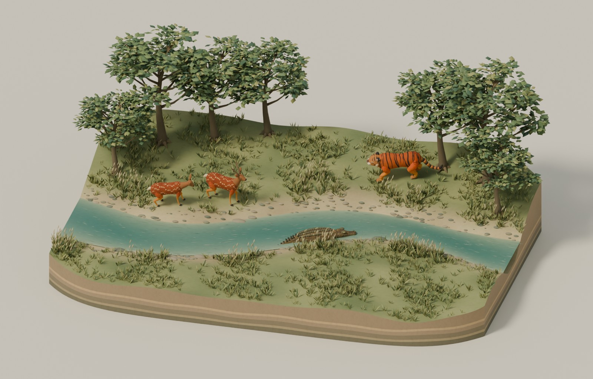

# 拉普蒂河漫滩



这是一组以尼泊尔奇特旺国家公园为原型的三维生态资产。沙岸往高处过渡为草地和娑罗树林。雄、雌花鹿停在林缘，孟加拉虎沿另一段草岸探头，沼泽鳄伏在浅水里。《SimulationWorld》提供了鹿、虎、鳄与河岸的生态关系，《万物有应》提供了青绿设色、Blender 建模和同一地表承载显示与点选的做法。[逐项参考来源](SOURCES.md)

## 看场景

- **Blender**　打开 [可编辑场景](assets/rapti-floodplain.blend)。按空格播放动物动作，按 F12 渲染全景。几何、材质、贴图、摄影机和灯光都在文件内。
- **浏览器**　在项目目录运行下列命令，然后打开[本地预览](http://127.0.0.1:5184)。拖动环看，滚轮或双指缩放。点击地面或水面可移动观察中心，顶部按钮可近看各物种，Home 回到全景。浏览器使用 WebGL 2，首次安装依赖需要联网。

```sh
npm ci
npm start
```

## 取用模型

[完整场景 GLB](assets/rapti-floodplain.glb) 带河床、水面、草丛、娑罗树和四只动物。三种动物也可分别导入其他三维项目。每个 GLB 都内嵌贴图和一个六秒循环。单体模型使用本地原点，单位为米，glTF 中 +Y 向上、+X 朝向动物头部。

| 动物 | 模型细节与动作 | 单体资源 |
| --- | --- | --- |
| 花鹿（白斑鹿） *Axis axis* | 栗色体侧带成行白斑，雄鹿每侧鹿角有三个尖。雄鹿抬低头，场景里的雌鹿无角，采用向前探身的姿势。 | [雄鹿 GLB](assets/chital.glb) · [渲染图](previews/chital.jpg) |
| 孟加拉虎 *Panthera tigris tigris* | 胁部、脸颊和四肢各有纹路，淡色口鼻、圆耳和带环纹的长尾可从侧面辨认。头和尾可独立转动。 | [孟加拉虎 GLB](assets/tiger.glb) · [渲染图](previews/tiger.jpg) |
| 沼泽鳄 *Crocodylus palustris* | 宽吻、头顶鼻孔和眼睛露出水面。背甲与尾脊建有实体几何，近看可见轻微张颌和摆尾。 | [沼泽鳄 GLB](assets/mugger.glb) · [渲染图](previews/mugger.jpg) |

## 重建与检查

使用 Blender 5.2.1 在项目根目录运行。生成脚本会重建 `assets/` 中的模型和 `previews/` 中的渲染。Blender 内对模型的手工修改请另存副本。

```sh
blender -b --python-exit-code 1 -P models/build.py
python3 models/check.py
```

[动物建模](models/fauna.py)与[河床、植被建模](models/floodplain.py)可分别修改。[原始材质贴图](textures/)随库保存。网页播放模型里的待机动作，生态参考仓库的种群、捕食和天气推演属于独立系统。
