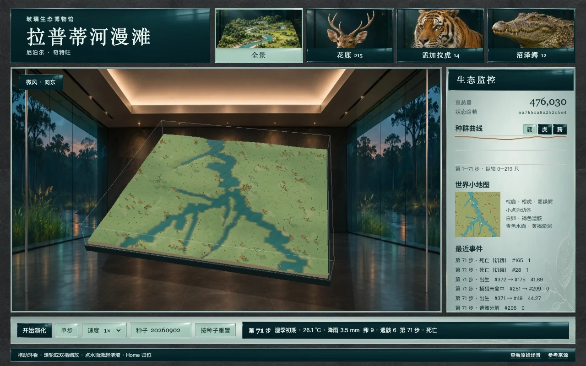

# 拉普蒂河漫滩 · 玻璃生态博物馆



这是一个以尼泊尔奇特旺国家公园为原型的三维生态模拟。HryYyR/SimulationWorld 的 Go 引擎生成河道并计算草量、水量、气候、觅食、捕猎、繁殖和死亡。浏览器把每个动物的编号、年龄和坐标映射到三维模型。《万物有应》提供了青绿设色、Blender 建模和点选地表的制作参考。上图为实时生态展柜，原始固定构图也可单独查看。[原始场景渲染](previews/rapti-floodplain.jpg)[逐项参考来源](SOURCES.md)

## 看场景

- **macOS 一键启动**　双击 [启动游戏.command](启动游戏.command)。需安装 Git、Go 1.22 或更新版本、Python 3 和 npm。首次启动会下载固定版本的上游源码及前端依赖，编译本机服务。生态接口就绪后自动打开浏览器。再次双击会在原端口 5184 重启，并以默认种子重新生成世界。若其他程序占用端口，脚本会显示程序名，由你决定是否结束它。
- **Blender**　打开 [可编辑场景](assets/rapti-floodplain.blend)。按空格播放动物动作，按 F12 渲染全景。几何、材质、贴图、摄影机和灯光都在文件内。
- **浏览器**　在项目目录运行下列命令，然后打开[本地预览](http://127.0.0.1:5184)。拖动环看，滚轮或双指缩放。点击地面或水面可移动观察中心，顶部按钮可近看各物种，Home 回到全景。浏览器使用 WebGL 2，首次安装依赖需要联网。

```sh
npm ci
npm start
```

## 玻璃生态博物馆

展厅中央是可环看的玻璃展柜，顶部四张图签可切换观察位置。演化控制、种群曲线、事件和小地图位于玻璃展板上，地图中的位置、曲线和数值随模拟更新。[界面美术与制作来源](SOURCES.md#玻璃生态博物馆的界面美术)

两种场景共用阵风和浅水波模型。靠近河岸可以看到草根固定、叶梢随风弯折；点水面会激起向周围传播并衰减的涟漪。实时场景还会根据降雨、游动和岸边饮水扰动水面。沼泽鳄等水中个体随局部波面起伏。暂停生态推演时仍可观察环境运动，系统的「减少动态效果」可以静止风草和水波。

展柜先用暖色侧光和冷色天空补光显示可操作的首帧。随后，后台线程读取并解压预计算的展厅环境光图集，在空闲时上传，约半秒内渐入到玻璃、水面和动物材质。环境光资源加载失败时仍可环看、跟随动物和推进模拟。靠近动物可观察蹄爪接地、躯干投影和鳄背高光，沿水面转动镜头可观察窗光倒影的变化。实时模式依据降雨量调节晴雨光比。[同镜头光影对照，左为调整前、右为调整后](previews/daylight-comparison.webp) · [布光方法、现场采光参考与材质授权](SOURCES.md#展柜日光与材质采光)

## 观察生态演化

首页默认进入实时世界。花鹿、孟加拉虎、沼泽鳄旁边的数字是当前存活数量。点一个物种可跟随实际个体，查看其编号、年龄和能量。幼体较小，遗骸和卵随快照出现、消失。草地颜色和草簇大小反映草量，河道随水量变化，在干涸处露出淤泥。

- 页面打开后自动演化。点「暂停」可停下来观察，「单步」推进一个模拟步。1×、5×、20× 分别以每秒 1、5、20 个真实单步为目标，按实际相邻位置补帧。底栏显示当前季节、气温、降雨和最近事件。
- 暂停后可以输入种子，点「按种子重置」生成新世界。同一服务的页面共享世界，刷新会读回当前进度。自动演化由前台页面驱动，切到后台或关闭页面时停止自动推进。重启服务后从头开始。
- 「查看原始场景」可以回到 Blender 制作的四只动物与固定河岸构图。「进入生态模拟」返回 Go 服务当前的世界。

右侧「生态监控」提供近 2000 个采样步的可切换种群曲线、最近 15 条事件、草总量、精确的 64 位状态哈希，以及带当前视野轮廓和幼体图例的小地图。动物近景显示个体编号、年龄、能量和当前动作。岸边饮水是根据停留位置选择的姿态。[动作来源与触发条件](SOURCES.md#动物动作参考与触发条件)

全景首屏使用轻量模型库，靠近动物后加载带贴图、舌部及下颌的精细模型。两档模型共享动作相位。重新生成运行时模型库可在项目根目录执行 `blender -b assets/rapti-floodplain.blend --python-exit-code 1 -P models/live_library.py`。

[实景性能验收与复测方式](PERFORMANCE.md)

## 后端与验证

仓库以 Git 子模块固定 [HryYyR/SimulationWorld 的 d663d08](https://github.com/HryYyR/SimulationWorld/tree/d663d08b13237c4cc53c3a8ba36468cf6aa30f01)。启动程序直接编译上游 `cmd/serve`，加载同一版本的 `cfg/`，并在同一端口提供三维页面和接口。用 Git 克隆本项目即可，启动程序会自动初始化子模块。

| 接口 | 用途 |
| --- | --- |
| `GET /api/state` | 读取当前世界，保持步数 |
| `POST /api/step` | 推进一步并返回快照 |
| `POST /api/run?n=5` | 批量推进并返回最终快照 |
| `POST /api/reset?seed=7` | 用指定种子重建世界 |

运行 `python3 -m unittest discover -s tests -v` 可验证启动与重启规则，并在临时端口检查初始世界、单步、批量推进、种群统计和同种子复现。运行 `npm test` 可检查三维模型的实际坐标、幼体缩放和死亡移除。运行 `cd upstream/SimulationWorld && go test ./...` 可执行上游测试。在此次 macOS 验证中，上游冒烟测试和 2000 步能量守恒测试通过。上游自带的 1000 步状态哈希与本机结果有差异，同一环境重复运行结果一致。

## 取用模型

[完整场景 GLB](assets/rapti-floodplain.glb) 带河床、水面、草丛、娑罗树和四只动物。三种动物也可分别导入其他三维项目。每个 GLB 都内嵌贴图和一个六秒循环。单体模型使用本地原点，单位为米，glTF 中 +Y 向上、+X 朝向动物头部。

| 动物 | 模型细节与动作 | 单体资源 |
| --- | --- | --- |
| 花鹿（白斑鹿） *Axis axis* | 栗色体侧带成行白斑，雄鹿每侧鹿角有三个尖。雄鹿抬低头，场景里的雌鹿无角，采用向前探身的姿势。 | [雄鹿 GLB](assets/chital.glb) · [渲染图](previews/chital.jpg) |
| 孟加拉虎 *Panthera tigris tigris* | 胁部、脸颊和四肢各有纹路，淡色口鼻、圆耳和带环纹的长尾可从侧面辨认。头和尾可独立转动。 | [孟加拉虎 GLB](assets/tiger.glb) · [渲染图](previews/tiger.jpg) |
| 沼泽鳄 *Crocodylus palustris* | 宽吻、头顶鼻孔和眼睛露出水面。背甲与尾脊建有实体几何，近看可见轻微张颌和摆尾。 | [沼泽鳄 GLB](assets/mugger.glb) · [渲染图](previews/mugger.jpg) |

## 重建与检查

使用 Blender 5.2.1 在项目根目录运行。生成脚本会重建 `assets/` 中的模型和 `previews/` 中的渲染。Blender 内对模型的手工修改请另存副本。

```sh
blender -b --python-exit-code 1 -P models/build.py
python3 models/check.py
```

[动物建模](models/fauna.py)与[河床、植被建模](models/floodplain.py)可分别修改。[原始材质贴图](textures/)随库保存。实时页面从这些模型导出远近两档几何，按连续快照驱动独立的肢体、颈颌与尾部动画。
